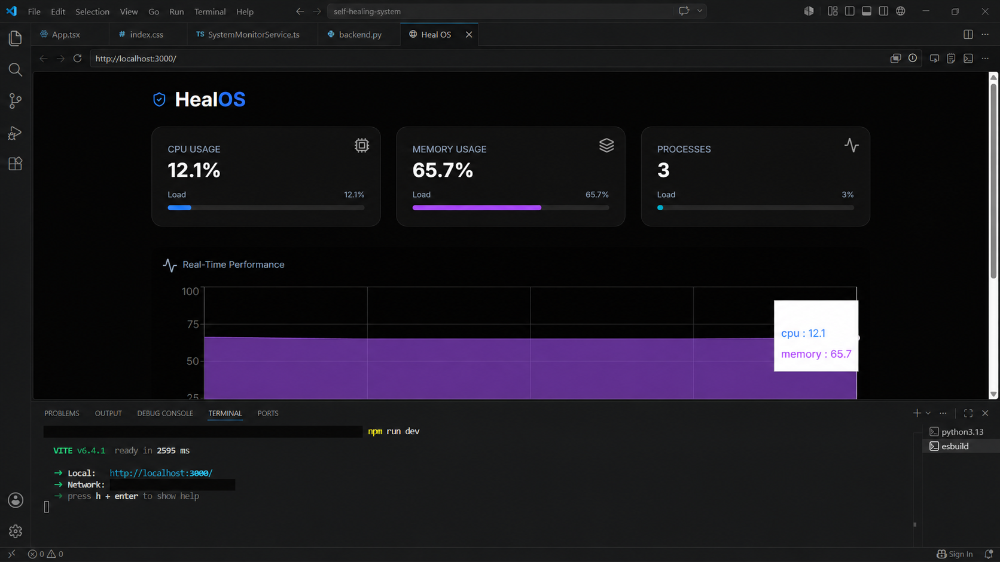
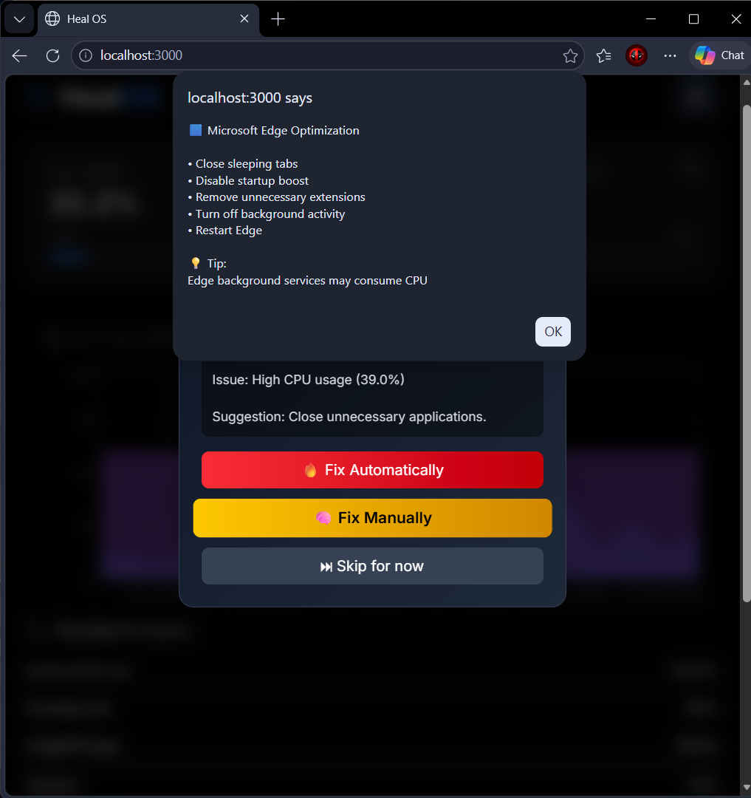
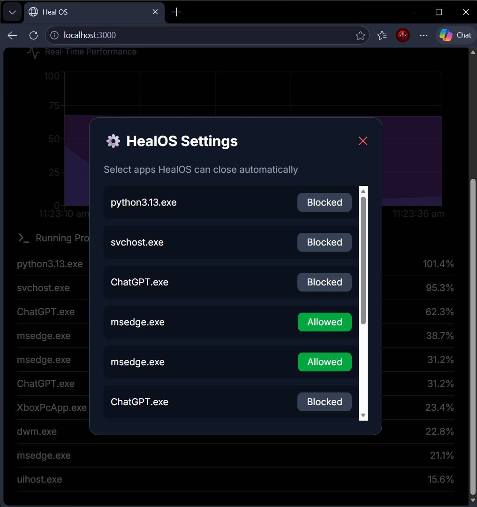

# HealOS

HealOS is a Windows desktop system-monitoring prototype. Its React dashboard displays CPU and memory use, charts recent readings, and lists running processes. A local Python service supplies the metrics. The dashboard can suggest manual steps and, after an explicit confirmation, request that the backend close a supported application.

> **Sanitized visual preview:** This edited image is based on an earlier demo capture. It masks local computer details and may differ slightly from the exact running interface.



## What it currently does

- Samples CPU and memory usage from the Windows computer running the backend.
- Displays recent CPU and memory readings in a live dashboard.
- Lists the busiest processes and flags supported apps that exceed the current CPU threshold.
- Offers manual suggestions and a confirmed close action for selected supported apps.
- Keeps the process-closing API on the local computer, checks the process ID against its expected name, and refuses unsupported or protected processes.

HealOS currently uses simple CPU-threshold rules. It does not perform AI diagnosis, automatic optimization, or background monitoring when the dashboard/backend is stopped. The `@google/genai` dependency is not currently used by the app.

## Requirements

- Windows 10 or 11
- Node.js 18 or newer with npm
- Python 3.10 or newer

## Run HealOS

Open two PowerShell windows in this project folder.

### 1. Start the local Python service

Create a virtual environment, then install the backend requirements into it:

```powershell
py -m venv .venv
.\.venv\Scripts\python.exe -m pip install -r requirements.txt
.\.venv\Scripts\python.exe backend.py
```

The API listens only on `127.0.0.1:5000`.

### 2. Start the dashboard

In a second PowerShell window:

```powershell
npm install
npm run dev
```

Open the local address printed by Vite (normally `http://127.0.0.1:3000`). Keep both PowerShell windows open while using HealOS.

## Safety notes

- The close request may terminate an application immediately without its own save prompt. Save your work first; HealOS asks for confirmation before sending the request.
- The backend only accepts close requests for its supported app list and checks the PID and process name before acting.
- Do not expose the backend or development dashboard to the internet or another network. They are designed for local development on your own Windows computer.
- Windows may deny permission to close some apps. If a request reports an error, check the app yourself before trying again.

## Project structure

```text
src/                         React dashboard and API client
backend.py                   Local Flask and psutil service
requirements.txt             Python backend dependencies
package.json                 Frontend scripts and dependencies
```

## Limitations and future work

- The current alerts use a fixed CPU threshold and a small supported-app list.
- Settings are stored in this browser only and are not synchronized between computers.
- More operating systems, user-configurable thresholds, accessibility improvements, and verified automated tests can be added later.
- AI-assisted diagnosis would need to be designed and implemented separately; the current app does not send system data to an AI service.

## Earlier demonstration screenshots

These screenshots document an earlier prototype build. The alert image includes the old “Fix Automatically” control, and the settings image uses the old automatic-close wording. The current source uses a confirmation before a supported app is terminated, so treat these as historical demonstration captures rather than screenshots of the current interface.




